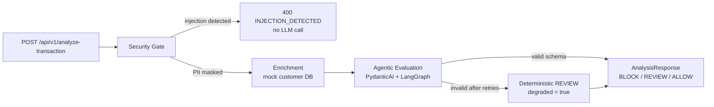

# Agentic SOC Transaction Analyzer

Decision-support POC for a bank Security Operations Centre. A flagged transaction is
security-gated, enriched from an internal customer profile, then evaluated by a
schema-constrained LLM agent that returns a risk score, a verdict, and an auditable
justification.

> **Scope.** This service never moves money and never executes a verdict. Output is
> advisory and always subject to existing fraud-operations controls.

---

## 1. Architecture



### Workflow nodes

| Node | Responsibility | Failure behaviour |
|---|---|---|
| `security_gate` | Validate payload (FastAPI/Pydantic), detect prompt injection, mask PAN/IBAN/email/phone before anything else sees the data | Raises `SecurityViolation` → HTTP 400, graph aborts, no enrichment, no LLM call |
| `enrichment` | Async mock of an internal customer-profile lookup (account age, 24h velocity, chargebacks, SARs, home country) | Mock only; in production wrap the DB call with its own timeout/circuit breaker |
| `agentic_evaluation` | Tool-free PydanticAI agent with `output_type=RiskAssessment`, strict schema, bounded retries, wall-clock timeout | After retries or any provider error: `REVIEW`, score `50`, `degraded = true`, audit event |

### State contract (`models.AnalysisState`)

`TypedDict` state with an append reducer on `audit_trail`. Nodes return partial updates
only; the security gate forwards a masked copy of the transaction, so the raw narrative
is never available to enrichment, the LLM, or the audit log.

```
request_id, transaction, masked_transaction, history, outcome, audit_trail[append]
```

Every node emits an immutable (`frozen=True`) `AuditEvent` and writes one JSON line.

### Request lifecycle

1. `RequestContextMiddleware` validates or generates `X-Request-ID` and binds it to a
   `ContextVar` used by every log line.
2. FastAPI/Pydantic rejects malformed payloads with `422 VALIDATION_ERROR`; input
   values are never echoed in the error body.
3. The security gate inspects the narrative and merchant category for injection
   heuristics. A match short-circuits with `400 INJECTION_DETECTED`.
4. PII is redacted in-place (`[REDACTED_PAN]`, `[REDACTED_IBAN]`, `[REDACTED_EMAIL]`,
   `[REDACTED_PHONE]`) before the state leaves the node.
5. Enrichment loads the customer profile (mocked with `asyncio.sleep`, no blocking I/O).
6. The agent receives JSON-serialized, masked data inside `<untrusted_data>` delimiters.
   PydanticAI enforces `RiskAssessment` (`extra="forbid"`, score 0–100, verdict enum,
   reason length). Invalid output is retried, then degraded.
7. The API returns the assessment plus an audit-event count. Model reasoning text is
   never returned verbatim to the caller.

---

## 2. OWASP Top 10 for LLMs — applied controls

| Risk | Control in this POC |
|---|---|
| **LLM01 Prompt Injection** | Fail-closed heuristic gate (`graph._INJECTION_RULES`), instruction/data separation in the system prompt, JSON-encoded untrusted data, no tools, output schema fixed. Heuristics are defense-in-depth, not the sole control. |
| **LLM02 Sensitive Information Disclosure** | PII masked before enrichment, prompt construction, and logging. Ambiguous "phone" matches are over-masked rather than under-masked. Error bodies contain no input. |
| **LLM03 Supply Chain** | Narrow dependency ranges; local OpenAI-compatible endpoint; no runtime model download. Production: hash-pinned lockfile, signed images, model provenance/approval. |
| **LLM04 Data and Model Poisoning** | Training/fine-tuning is out of scope. The runtime model is treated as untrusted; every output is schema-validated and advisory. |
| **LLM05 Improper Output Handling** | `RiskAssessment` with `extra="forbid"`, enum verdict, integer bounds, length caps. Output is never evaluated as code, SQL, or a command. |
| **LLM06 Excessive Agency** | Tool-free agent; verdict is decision support only; no transaction execution path exists in the service. |
| **LLM07 System Prompt Leakage** | Prompt forbids disclosure, data is delimited, and exfiltration patterns are blocked at the gate. The prompt contains no secrets anyway. |
| **LLM08 Embedding Weaknesses** | Not applicable: no RAG or vector store in this workflow. |
| **LLM09 Misinformation** | Deterministic `REVIEW` fallback on any validation/provider failure, `degraded` flag, audit reason, human-in-the-loop by design. |
| **LLM10 Unbounded Consumption** | Input length caps, bounded retries (`LLM_RETRIES` ≤ 5), wall-clock timeout, single-shot prompt. Production: gateway rate limits and per-tenant quotas. |

Additional API controls: centralized exception handlers, uniform error envelope,
`X-Request-ID` correlation, restricted CORS (none configured), and no stack traces in
responses.

---

## 3. Audit trail

Every state transition produces one structured JSON line, for example:

```json
{"timestamp":"2026-11-09T18:32:13.949+00:00","level":"INFO","logger":"soc.graph",
 "service":"agentic-soc-analyzer","message":"audit_event",
 "request_id":"a231d125c370467bbb482518fca3a4ba",
 "audit":{"event_id":"...","request_id":"...","node":"enrichment",
          "action":"customer_history_loaded","outcome":"OK",
          "occurred_at":"2026-11-09T18:32:13.949+00:00",
          "detail":{"new_customer":false,"home_country":"US","country_mismatch":false,
                    "chargebacks_last_12m":0,"prior_sar_filings":0}}}
```

Audit records contain identifiers, booleans, counts, and verdict metadata only — never
narratives, amounts, card numbers, or raw model text. Events are Pydantic-frozen
in-process; **production must ship them to a WORM/SIEM sink** (append-only object
storage or the bank's audit platform) to be tamper-evident.

---

## 4. Configuration

Environment variables (`.env` is read automatically, process env wins):

| Variable | Default | Notes |
|---|---|---|
| `SERVICE_NAME` | `agentic-soc-analyzer` | Emitted on every log line |
| `LOG_LEVEL` | `INFO` | Standard logging levels |
| `LLM_BASE_URL` | `http://localhost:11434/v1` | Any OpenAI-compatible endpoint |
| `LLM_MODEL` | `qwen2.5:7b-instruct` | Must support tool calling / structured output |
| `LLM_API_KEY` | `ollama-local` | Dummy for local Ollama; use a secret manager in production |
| `LLM_RETRIES` | `2` | Schema-validation retries, capped at 5 |
| `LLM_TIMEOUT_SECONDS` | `30` | Hard wall-clock timeout per evaluation |

The service starts even if the provider is unreachable; requests degrade to `REVIEW`
and are audited. No secrets are logged or committed.

---

## 5. Running

Requires Python 3.12+ (verified on 3.13).

```powershell
python -m venv .venv
.venv\Scripts\Activate.ps1
pip install -r requirements.txt
uvicorn main:app --reload --port 8000
```

Optional local model:

```powershell
ollama pull qwen2.5:7b-instruct
ollama serve
```

Health check: `GET /healthz`.

### Example

```powershell
curl.exe -X POST http://127.0.0.1:8000/api/v1/analyze-transaction `
  -H "Content-Type: application/json" `
  -H "X-Request-ID: demo-request-0001" `
  -d '{\"transaction_id\":\"TXN-2026-0001\",\"customer_id\":\"CUST-1001\",\"amount\":\"142.75\",\"currency\":\"USD\",\"occurred_at\":\"2026-11-09T14:22:00Z\",\"channel\":\"CARD_PRESENT\",\"merchant_country\":\"US\",\"merchant_category\":\"GROCERY\",\"narrative\":\"Card present purchase; card 4111 1111 1111 1111.\"}'
```

```json
{
  "request_id": "demo-request-0001",
  "transaction_id": "TXN-2026-0001",
  "risk_score": 18,
  "verdict": "ALLOW",
  "audit_reason": "Low-value card-present purchase consistent with 24h activity and no chargebacks.",
  "degraded": false,
  "audit_events": 3
}
```

Error envelope:

```json
{"error":{"code":"INJECTION_DETECTED","message":"Request blocked by the security gate.","request_id":"..."}}
```

---

## 6. Tests

```powershell
.venv\Scripts\python.exe -m pytest -q
```

The suite is fully offline: `pydantic_ai.models.function.FunctionModel` replaces the
provider, so no model server, API key, or network access is required.

| Test | Proves |
|---|---|
| `test_valid_transaction_is_allowed_and_pii_never_reaches_the_llm` | Happy path returns `ALLOW`/3 audit events; the captured prompt contains `[REDACTED_PAN]` and not the raw card number; audit records cover all three nodes |
| `test_prompt_injection_is_rejected_before_any_llm_call` | `400 INJECTION_DETECTED`, model invocation count is zero, attacker text is not reflected |
| `test_schema_hallucination_retries_then_degrades_to_review` | Invalid schema (`risk_score=999`, unknown verdict) is retried, then produces `REVIEW`/`50`/`degraded=true` instead of a 500 |

The fallback was also verified against a real unreachable provider: the endpoint returns
`200` with `verdict=REVIEW`, `degraded=true` and `ModelAPIError` recorded in the audit log.

---

## 7. Production hardening roadmap

- OIDC/mTLS service authentication, per-client authorization, gateway rate limits.
- Replace the mock DB with a read-replica repository using timeouts, retries, and a
  circuit breaker; add schema-level column allowlists.
- Move audit events to an append-only sink with retention, integrity hashing, and SIEM
  correlation; emit OpenTelemetry traces with PII scrubbing.
- Prompt/regression evaluation set, red-team corpus, and drift monitoring per model
  version; pin model artifacts and require change approval.
- Persist LangGraph checkpoints for replayable investigations and route `REVIEW`
  outcomes into the existing case-management queue.
- Secrets via vault/KMS, key rotation, and per-tenant cost/quota budgets.

---

## 8. Layout

```
models.py    Pydantic I/O schemas, config, typed LangGraph state, audit model
agent.py     PydanticAI agent, prompt construction, retry/timeout, REVIEW fallback
graph.py     Security gate, PII masking, injection heuristics, enrichment, graph
main.py      FastAPI app, JSON audit logger, middleware, exception handlers, routes
test_main.py Offline pytest suite (happy path, injection, schema hallucination)
```
